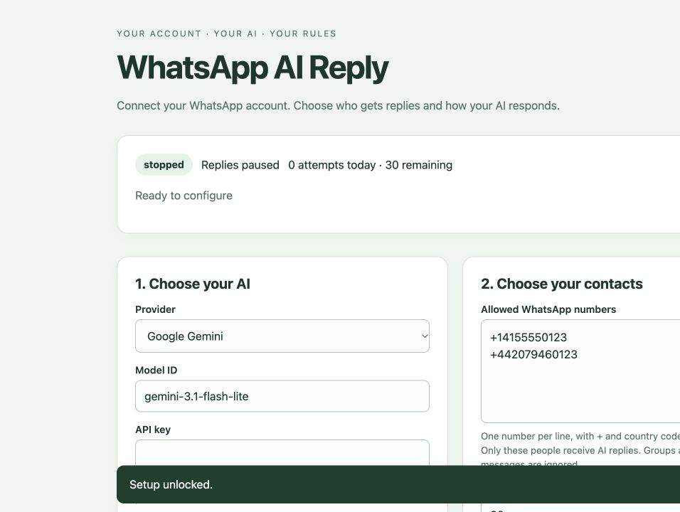

# WhatsApp AI Reply

Self-hosted AI replies for your existing WhatsApp account, running on Cloudflare Workers. Choose your AI provider, allow specific contacts, and edit the reply instructions in a private setup page. No always-on computer or MCP server is required after deployment.

**Early release.** The underlying single-contact Gemini approach has been used successfully, but this generalized release has not been live-tested with every provider/model. Automated checks cover provider request formats, filtering, contact-memory isolation, limits, authentication and persistence. An unofficial linked-device connection can lead to WhatsApp account restrictions.



## Features

- Gemini, OpenAI, Anthropic Claude, OpenRouter, and custom OpenAI-compatible **Chat Completions** APIs.
- Your own API key and model ID. Custom services need a public HTTPS base URL.
- 1–20 allowed WhatsApp contacts; full numbers with country codes. Groups and messages from your own account are ignored.
- Editable reply instructions, daily attempted-reply cap and per-contact cooldown.
- Optional RAM-only memory: four exchanges per contact, expiring after 30 minutes idle. Never mixed across contacts.
- Private QR pairing, pause/resume, stop, reset and clear-memory controls.
- Saved-key reuse, a connection-test button and a usage/status display. Keys are never returned by the settings API.
- SQLite session persistence and scheduled connection recovery. No chat-content logging or history download.

## What runs where?

```text
Allowed contact → WhatsApp linked device → Cloudflare Durable Object
                                             ↓
                                  selected AI provider
                                             ↓
                              🤖 reply in the same chat
```

The QR code links the account that **sends** replies. The phone numbers in settings select who **receives** replies. Entering a phone number is not a way to log into WhatsApp.

One deployment serves one WhatsApp account. This is a self-hosted application, not a public multi-user chatbot hosting service.

## Before you start

- Node.js 24, npm, a Cloudflare account with Workers access, and WhatsApp on your phone.
- An API key and text-chat model ID from your chosen AI provider.
- A strong setup password (generated below).

Cloudflare Free is a plausible fit for one low-volume account, not an uptime guarantee. At the currently documented 128 MB allocation, one continuously active object consumes approximately 11,059 GB-s/day of the 13,000 GB-s/day free allowance. Account-wide activity, requests and SQLite writes also count. Limits fail closed on Free. Check [current pricing](https://developers.cloudflare.com/durable-objects/platform/pricing/) before deploying.

**AI billing is separate.** Using an arbitrary provider key does not mean free AI. Choose a free-tier project if available or set a spending limit with the provider. The bot's reply cap counts attempts, not currency or tokens.

## Install and deploy

```sh
git clone https://github.com/mikotokuroko/whatsapp-ai-reply.git
cd whatsapp-ai-reply
npm ci --ignore-scripts
npm run setup
npm run check
```

`npm run setup` creates a private, ignored `.dev.vars` file containing `ADMIN_TOKEN`. It never replaces an existing file or prints the password. Open that file locally to copy the value; do not share it or commit it.

For a local preview:

```sh
npm run dev
```

For Cloudflare deployment:

```sh
npx wrangler login --scopes account:read user:read workers:write workers_scripts:write
npm run deploy -- --secrets-file .dev.vars
```

Choose the intended Cloudflare account when prompted. The supplied `wrangler.jsonc` has no account ID. Pick a different Worker name there if `whatsapp-ai-reply` is already in use. Deployment creates one SQLite Durable Object namespace and a workers.dev URL; it does not upgrade your billing plan.

Open the URL printed by Wrangler, unlock with `ADMIN_TOKEN`, then:

1. Select the provider and enter its model ID and API key.
2. Enter allowed contact numbers, one per line.
3. Set instructions, reply limits and optional memory; click **Save settings**.
4. Optionally click **Save & test AI connection**. This makes a small provider request, may incur charges, and sends no WhatsApp message. Tests are limited to 10 per UTC day.
5. Click **Show pairing code / reconnect**. On your phone, use **WhatsApp → Settings → Linked devices → Link a device**.
6. Once connected, click **Enable replies** and have an allowed contact send a fresh text message.

## Supported APIs

| Selection | API format | Endpoint |
| --- | --- | --- |
| Gemini | Native generateContent | Google Gemini Developer API |
| OpenAI | Chat Completions | api.openai.com/v1 |
| Anthropic Claude | Native Messages, version 2023-06-01 | api.anthropic.com/v1 |
| OpenRouter | Chat Completions | openrouter.ai/api/v1 |
| Custom | OpenAI-compatible Chat Completions | Your HTTPS base URL + /chat/completions |

This does not promise compatibility with every model: Responses-only models, tool-only/audio/image models, special authentication schemes and provider-specific request requirements are outside this release. No tools, grounding, media processing, streaming or automatic paid fallback. Output is capped at 768 tokens and 3,500 characters; some reasoning-heavy models may return no text within that budget. Use **Test AI connection** to check your selected model.

Changing provider or custom API address requires a new key; an existing key is never silently carried to another destination. Redirects are rejected. Custom endpoints cannot use HTTP, explicit IP addresses, local hostnames, credentials in URLs or nonstandard ports. Only use a domain you trust and control or a known provider: validation does not attest to a domain's owner or its DNS configuration.

## Settings and behavior

- Defaults: 30 attempted AI replies/day across contacts, 10-second cooldown per contact. Adjustable to 1–1,000 attempts/day and 1–3,600 seconds.
- Counts reset at **00:00 UTC**. Failed AI attempts count. Limit/cooldown skips appear in the setup status and are not retried later.
- A queue holds up to five eligible messages. Text longer than 4,000 characters, old messages, attachments, groups, own messages and history events are ignored.
- Duplicate claims survive restarts for two days. A failed or uncertain send is not retried automatically, so an interrupted reply can be lost.
- Memory is off by default, separate per contact and RAM-only. Restart, pause, stop, clearing memory or changing settings erases it.
- Saving settings does not require re-pairing. It cancels pending responses based on old settings. Every reply starts with 🤖.
- An alarm runs every minute while connected/running. It restores saved sessions and respects terminal retry delays. The library handles transient reconnect backoff; the app does not restart it during backoff.
- Logout, replaced sessions and rejected protocol builds need manual attention. QR pairing expires after five minutes.
- A deployment may briefly reconnect the linked device. If an old object keeps running after an update, stop the connection in the setup page, wait briefly, then reconnect and enable replies. Do not reset or delete its saved login for a routine update.

## Privacy and security

The admin password grants full control of this bot. The API key, allowed numbers, instructions and WhatsApp credentials are stored in private Durable Object storage. No public API exposes them; the authenticated setup page returns settings without the API key. Application logs and Cloudflare observability are disabled by default.

A WhatsApp linked device can receive other chats. The allowlist controls application processing and responses, **not** the linked device's account-level access. The app disables historical sync and forwards only eligible text plus any enabled per-contact memory to the chosen AI provider. That provider's privacy, training, retention, region and billing terms apply. The WhatsApp library persists protocol/cryptographic state, which may include retry records; “memory off” does not mean the protocol stores nothing.

Never commit `.dev.vars`, `.private`, `.wrangler`, credentials, QR codes, exported chat data or a deployment-specific account configuration. No credentials, accounts or existing live setup are included in this repository.

To disconnect, stop the bot and unlink it in WhatsApp. **Reset** deletes its saved WhatsApp login but retains AI settings and usage. To remove all cloud data, delete the deployment and its associated Durable Object resources using Cloudflare's documented procedures; this is separate from Reset.

## Development

```sh
npm run check  # unit tests, TypeScript, lint, deployment dry run
npm run smoke  # real local workerd: authentication, settings, restart persistence
```

Tests use synthetic contacts and keys. They never pair a WhatsApp account or call a paid AI API. GitHub Actions runs both checks. No automatic deployment workflow is included.

Source layout: `worker.ts` owns connection and queue state; `settings.ts` validates configuration; `ai.ts` adapts provider requests; `messages.ts` filters contacts and isolates memory; `storage.ts` persists protocol records and duplicate claims; `page.ts` serves the private admin UI.

MIT licensed. See [LICENSE](LICENSE) and [dependency/reference notes](THIRD_PARTY.md).
